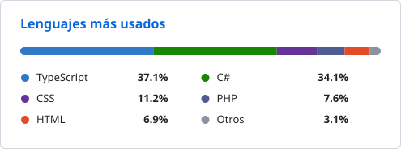

# Hola, llegaste al Git de Cristian 👋

Estudiante y desarrollador web. 
Trabajo sobre todo en sistemas webs, construyendo sitios responsivos y sistemas de gestión interna.

<!-- Si quieres mostrar tu correo públicamente, descomenta la línea de abajo:

-->

## 📊 Estadísticas

<!-- LANGS:START -->
<picture>
  <source media="(prefers-color-scheme: dark)" srcset="https://raw.githubusercontent.com/Cristian-Mtzzz/Cristian-Mtzzz/main/assets/lenguajes-dark.svg?v=737594d8">
  <source media="(prefers-color-scheme: light)" srcset="https://raw.githubusercontent.com/Cristian-Mtzzz/Cristian-Mtzzz/main/assets/lenguajes-light.svg?v=737594d8">
  
</picture>
<!-- LANGS:END -->

## 🛠️ Tech Stack

**Lenguajes**

![C#](https://img.shields.io/badge/C%23-239120?style=flat&logo=data:image/svg%2Bxml;base64,PHN2ZyBmaWxsPSIjZmZmZmZmIiB4bWxucz0iaHR0cDovL3d3dy53My5vcmcvMjAwMC9zdmciIHZpZXdCb3g9IjAgMCAxMjggMTI4Ij48cGF0aCBkPSJNMTA5IDUwaC00LjhsLTEuMiA2aC0zLjhsMS4yLTZoLTQuOWwtMS4yIDZIODl2NWg0LjRsLS45IDRIODl2NWgyLjVsLTEuMiA2aDQuOGwxLjItNmgzLjhsLTEuMiA2aDQuOWwxLjItNmg1di01aC00LjFsLjktNGgzLjJ2LTVoLTIuMmwxLjItNnptLTcuOSAxNWgtMy44bC45LTRoMy44bC0uOSA0em0xNS40LTMyLjdjLS42LTEuMS0xLjQtMi4xLTIuMy0yLjZMNjYuMSAxLjljLS44LS41LTEuOS0uNy0zLjEtLjctMS4yIDAtMi4zLjMtMy4xLjdMMTEuNCAyOS43Yy0xLjcgMS0zLjQgMy41LTMuNCA1LjR2NTUuN2MwIDEuMS43IDIuMyAxLjQgMy40bC4xLjFjLjUuOCAxLjMgMS41IDIgMS45bDQ4LjMgMjcuOWMuOC41IDIgLjcgMy4yLjcgMS4yIDAgMi4zLS4zIDMuMS0uN2w0Ny41LTI3LjljMS43LTEgMi40LTMuNSAyLjQtNS40VjM1LjFjMC0uOC40LTEuOCAwLTIuNmwuNS0uMnptLTQuMiAyLjFjMCAuMy0uMy41LS4zLjd2NTUuN2MwIC44LS4yIDEuNy0uNCAyTDY0IDEyMC42Yy0uMS4xLS41LjItMS4xLjItLjYgMC0xLS4xLTEuMS0uMkwxMy42IDkyLjhzLS4xLS4xLS4yLS4xbC0uNi0uNmMtLjQtLjcuMi0xLjEtLjgtMS4yVjM1LjJjMS0uNS45LTEuNyAxLjQtMS45TDYxLjcgNS40Yy4xIDAgLjYtLjIgMS4yLS4yczEgLjEgMS4xLjJsNDggMjcuNy40LjljLjEuMS0uMS4zLS4xLjR6TTYzIDg3LjVjLTEzLjUgMC0yNC41LTExLTI0LjUtMjQuNXMxMS0yNC41IDI0LjUtMjQuNWM5LjEgMCAxNy4xIDUgMjEuMyAxMi41bDEzLTcuNWMtNi44LTExLjktMTkuNi0yMC0zNC4zLTIwLTIxLjggMC0zOS41IDE3LjctMzkuNSAzOS41czE3LjcgMzkuNSAzOS41IDM5LjVjMTQuNiAwIDI3LjQtOCAzNC4yLTE5LjhsLTEyLjktNy42QzgwLjEgODIuNSA3Mi4xIDg3LjUgNjMgODcuNXoiIGZpbGw9IiNmZmZmZmYiLz48L3N2Zz4%3D)

**Frontend**

**Frameworks y Runtime**

**Bases de datos**

**Herramientas**

